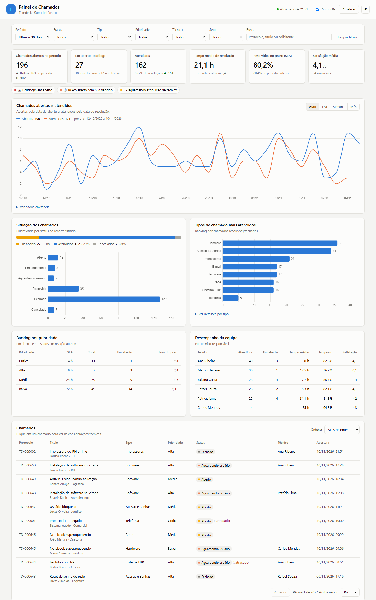

# Thindesk: Dashboard Administrativo de Chamados

Painel administrativo integrado ao sistema de chamados **Thindesk**, com API REST própria para indicadores, análise por período, situação dos chamados, ranking de tipos, filtros e tratamento de dados.



## Como executar

Requisitos: **Node.js 22+**. O banco de dados é **SQLite** (embarcado via `better-sqlite3`): não é preciso instalar nem configurar servidor de banco.

```bash
npm install
npm start
```

- Dashboard: <http://localhost:3000>
- API: <http://localhost:3000/api/v1/saude>

Na primeira execução o banco `data/thindesk.db` é criado (esquema em [src/data/schema.sql](src/data/schema.sql)) e populado com ~650 chamados de exemplo dos últimos 180 dias. Para recriar o banco (ex.: para trazer as datas para o presente):

```bash
npm run seed                                  # padrão: 650 chamados, 180 dias
npm run seed -- --quantidade 1000 --dias 365
```

> `npm run seed` apaga o banco atual. Pare o servidor antes de executar.

Variáveis de ambiente opcionais: `PORT` (padrão 3000) e `DB_ARQUIVO` (caminho do banco SQLite).

Para inspecionar o banco, abra `data/thindesk.db` em qualquer cliente SQLite (ex.: [DB Browser for SQLite](https://sqlitebrowser.org/) ou a extensão *SQLite Viewer* do VS Code).

## Testes

```bash
npm test
```

62 testes automatizados (unidade, banco de dados e integração da API). Detalhes e evidências em [docs/TESTES.md](docs/TESTES.md).

## Documentação

| Documento | Conteúdo |
|-----------|----------|
| [docs/DOCUMENTACAO.md](docs/DOCUMENTACAO.md) | Requisitos funcionais e não funcionais, arquitetura, modelo de dados, regras de negócio |
| [docs/API.md](docs/API.md) | Endpoints: parâmetros, exemplos de requisição/resposta e erros |
| [docs/TESTES.md](docs/TESTES.md) | Evidências de testes automatizados, manuais e do dashboard |

## Apresentação

Vídeo de até 3 minutos demonstrando o funcionamento do sistema. As decisões de análise e projeto estão detalhadas na [DOCUMENTACAO.md](docs/DOCUMENTACAO.md). Vídeo: **[docs/apresentacao.mp4](docs/apresentacao.mp4)**

## Versionamento (gitflow)

| Branch | Conteúdo |
|--------|----------|
| `main` | Versão entregue (tag `v1.0.0`) |
| `develop` | Integração das features |
| `feature/banco-de-dados` | Esquema SQLite, repositório SQL e base de exemplo |
| `feature/api-endpoints` | Endpoints da API integrados ao banco e testes |
| `feature/dashboard` | Painel administrativo |
| `feature/documentacao` | Documentação e evidências |
| `release/1.0.0` | Preparação da entrega |

Detalhes na seção 8 da [DOCUMENTACAO.md](docs/DOCUMENTACAO.md#8-versionamento-gitflow).

## Funcionalidades

| Requisito | No dashboard | Endpoint |
|-----------|--------------|----------|
| RF01 Indicadores gerais | Cartões de total, backlog, atendidos, tempo médio, SLA, satisfação + alertas | `GET /api/v1/dashboard/indicadores` |
| RF02 Atendidos por período | Gráfico abertos × atendidos por dia/semana/mês | `GET /api/v1/dashboard/periodo` |
| RF03 Situação dos chamados | Distribuição por status, backlog por prioridade, detalhe com considerações técnicas | `GET /api/v1/dashboard/status`, `GET /api/v1/chamados/{id}` |
| RF04 Tipos mais atendidos | Ranking em barras + tabela | `GET /api/v1/dashboard/tipos` |
| RF05 Filtros | Período, status, tipo, prioridade, técnico, setor, busca (salvos na URL) | Parâmetros comuns a todos os endpoints |
| RF06 Integração com a API | Todo o conteúdo vem da API (`public/js/api.js`) | `/api/v1/*` |
| RF07 Atualização e tratamento | Atualização a cada 60 s, aviso de falha preservando dados, normalização na importação | `POST/PATCH /api/v1/chamados`, `POST /api/v1/dados/importar`, `GET /api/v1/qualidade-dados` |

## Estrutura

```
├── public/              # Dashboard (HTML, CSS, JS)
│   ├── index.html
│   ├── css/estilo.css
│   └── js/api.js        # cliente da API
│       js/app.js        # lógica do painel e gráficos (Chart.js)
├── src/
│   ├── server.js        # inicialização
│   ├── app.js           # Express, rotas de sistema, tratamento de erros
│   ├── dominio.js       # status, prioridades, SLA, tipos, transições
│   ├── routes/          # dashboard.js, chamados.js
│   ├── services/        # filtros.js, metricas.js, tempo.js
│   └── data/            # schema.sql, store.js (repositório SQL), normalizador.js, gerador.js
├── data/                # thindesk.db (gerado, fora do git)
├── scripts/             # seed.js, evidencias-api.sh
├── tests/               # testes automatizados
└── docs/                # documentação e evidências
```

## Tecnologias

Node.js 22 · Express 4 · SQLite (better-sqlite3) · HTML/CSS/JavaScript · Chart.js 4 · `node:test`
