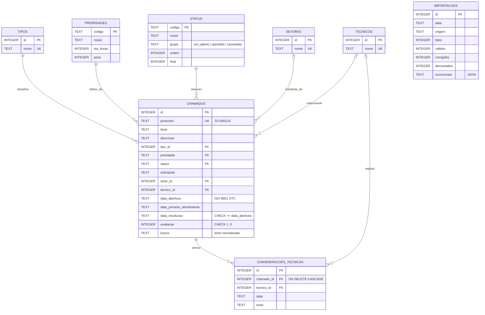
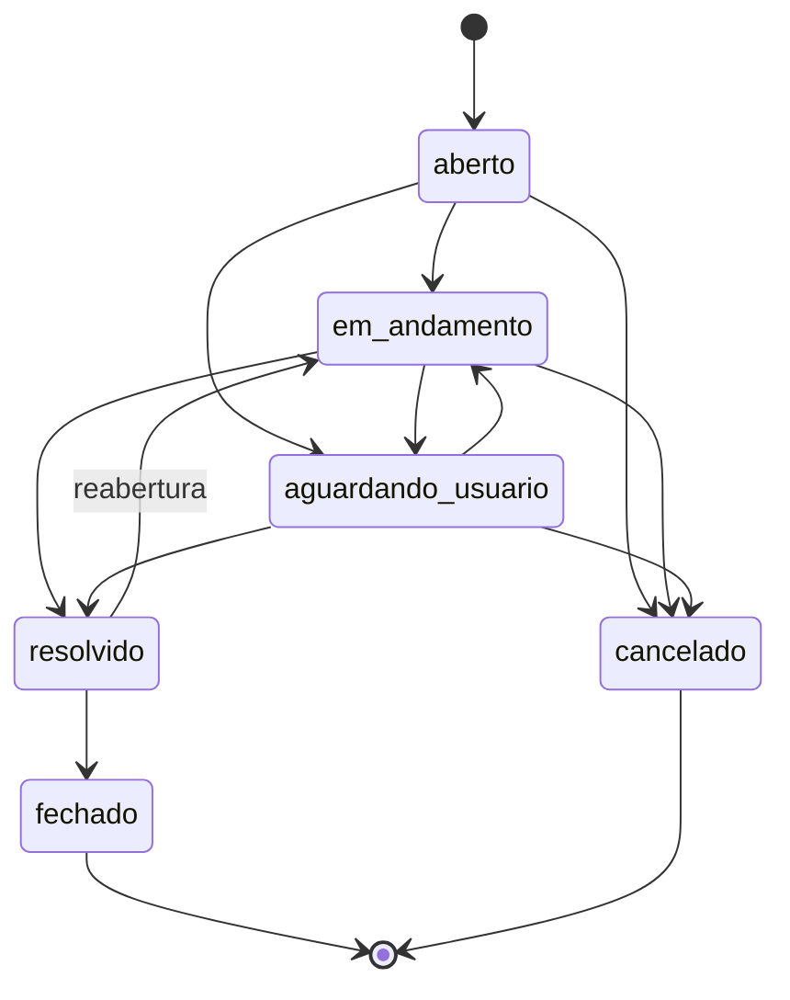

# Dashboard Administrativo Thindesk: Documento do Projeto

## 1. Contexto

O **Thindesk** é um sistema de chamados técnicos (help desk). Este projeto adiciona um **Dashboard Administrativo** para o responsável pela área de suporte acompanhar a operação: volume de chamados, andamento, situação, tipos mais atendidos, cumprimento de prazos (SLA), desempenho da equipe e as considerações técnicas registradas em cada atendimento.

O painel consome exclusivamente uma **API REST** própria, projetada e implementada neste trabalho, o que permite que outros sistemas (ex.: o próprio Thindesk, uma ferramenta de BI) consumam os mesmos indicadores.

## 2. Requisitos funcionais

| ID | Requisito | Como foi atendido |
|----|-----------|-------------------|
| **RF01** | Indicadores gerais de chamados técnicos | Cartões com total de chamados no período, backlog em aberto, atendidos e taxa de resolução, tempo médio de resolução e de 1º atendimento, % resolvido dentro do SLA e satisfação média. Mostra a variação em relação ao período anterior de mesmo tamanho e alertas (críticos em aberto, SLA vencido, sem técnico). Endpoint `GET /dashboard/indicadores`. |
| **RF02** | Análise de chamados atendidos por período (gráficos) | Gráfico de linhas "abertos × atendidos" agrupado por dia, semana ou mês (automático conforme o intervalo), com tooltip, legenda com totais e tabela de dados. Endpoint `GET /dashboard/periodo`. |
| **RF03** | Situação dos chamados | Barra de proporção (em aberto / atendidos / cancelados), gráfico de barras por status e tabela de backlog por prioridade com chamados fora do prazo. Endpoint `GET /dashboard/status`. |
| **RF04** | Tipos de chamados mais atendidos | Ranking em barras horizontais e tabela com posição, atendidos, em aberto, tempo médio e % no prazo. Endpoint `GET /dashboard/tipos`. |
| **RF05** | Filtros de consulta | Período (7/30/90/180 dias, todo o histórico ou datas personalizadas), status, tipo, prioridade, técnico (inclusive "sem técnico"), setor e busca textual. Os filtros valem para todos os gráficos e tabelas e ficam na URL (link compartilhável). Todos os endpoints aceitam os mesmos parâmetros. |
| **RF06** | Integração com a API | O front-end não tem dados embutidos: tudo vem da API via `fetch` (módulo `public/js/api.js`), com timeout, tratamento de erros HTTP e cancelamento de requisições obsoletas. |
| **RF07** | Atualização e tratamento de dados | **Atualização:** recarga automática a cada 60 s (pausada com a aba oculta), botão "Atualizar", indicador de última atualização e endpoints `POST/PATCH /chamados` que refletem imediatamente nos indicadores. **Tratamento:** normalização dos registros em toda importação, inclusive a de outros sistemas via `POST /dados/importar` (caixa, espaços, acentos, rótulo × código), descarte de registros inválidos com relatório gravado no banco (`GET /qualidade-dados`), restrições de integridade no esquema SQL, validação de parâmetros e regras de negócio no fluxo de atendimento; em caso de falha, o painel mantém os últimos dados válidos e exibe aviso com "Tentar novamente". |

Funcionalidades complementares: detalhe do chamado com linha do tempo das **considerações técnicas**, desempenho por técnico, lista paginada de chamados com ordenação, tema claro/escuro.

## 3. Requisitos não funcionais

| ID | Requisito | Atendimento |
|----|-----------|-------------|
| RNF01 | **Desempenho:** respostas dos endpoints de dashboard em menos de 300 ms para a base de exemplo (~650 chamados). | Agregações feitas no banco (SQL com índices); medido entre 2 e 6 ms por endpoint ([evidência](evidencias/tempos-resposta.txt)). |
| RNF02 | **Usabilidade:** painel compreensível sem treinamento, com rótulos em português e unidades explícitas (h, dias, %). | Formatação `pt-BR`, legendas com totais, tooltips, subtítulos explicando cada métrica. |
| RNF03 | **Responsividade:** uso em desktop e celular. | Layout em grade que passa a uma coluna abaixo de 900 px; tabelas com rolagem horizontal. |
| RNF04 | **Acessibilidade:** informação nunca dependente apenas de cor; navegação por teclado. | Status com texto + cor, ícone em alertas, tabela alternativa para os gráficos, linhas da lista acionáveis por Enter, foco visível, paleta validada para daltonismo, tema escuro. |
| RNF05 | **Confiabilidade:** falhas da API não podem deixar o painel em branco. | `Promise.allSettled` por bloco, últimos dados válidos preservados, timeout de 10 s, aviso de erro. |
| RNF06 | **Padronização da API:** REST, JSON, versionada, erros em formato único. | Prefixo `/api/v1`, envelope `{ dados, meta }`, erros `{ erro: { status, codigo, mensagem, detalhes } }`, códigos HTTP semânticos (200/201/400/404/413/422/500). |
| RNF07 | **Segurança básica:** entrada sempre validada; sem injeção de SQL ou HTML. | Validação de query e corpo, limite de 100 KB no corpo (5 MB na importação), consultas SQL sempre parametrizadas (sem SQL injection), escape de HTML em todo conteúdo renderizado, `x-powered-by` desativado. |
| RNF08 | **Interoperabilidade:** outros sistemas podem consumir a API. | CORS liberado para `GET/POST/PATCH`, `Cache-Control: no-store` em dados operacionais. |
| RNF09 | **Fuso horário:** datas agrupadas no horário de Brasília. | Agrupamentos e filtros de data calculados em UTC−03:00 (testado). |
| RNF10 | **Manutenibilidade e testabilidade:** código modular e coberto por testes automatizados. | Camadas separadas (rotas, serviços, repositório); todo o SQL concentrado em `store.js`; relógio e banco injetáveis (testes usam banco em memória); 62 testes com `node:test`. |
| RNF11 | **Portabilidade:** execução com um único comando, sem instalar servidor de banco. | Node.js ≥ 22 + Express + SQLite embarcado (`better-sqlite3`); banco criado e populado automaticamente na primeira execução. |
| RNF12 | **Integridade dos dados:** o banco rejeita dados inconsistentes mesmo fora da API. | Chaves estrangeiras, `UNIQUE`, `CHECK` (avaliação 1 a 5, resolução após abertura), gravações em transação. |

## 4. Arquitetura

```
┌──────────────────────────┐   HTTP/JSON    ┌──────────────────────────────────────────┐
│ Dashboard (navegador)    │ ─────────────▶ │ API Express  /api/v1                     │
│ public/index.html        │                │  routes/dashboard.js  → indicadores...   │
│ public/js/api.js  (RF06) │ ◀───────────── │  routes/chamados.js   → CRUD e fluxo     │
│ public/js/app.js         │                │  services/filtros.js  → RF05 (validação) │
│ Chart.js 4.4.1           │                │  services/metricas.js → monta RF01-RF04  │
└──────────────────────────┘                │  data/normalizador.js → RF07 tratamento  │
                                            │  data/store.js        → repositório SQL  │
                                            └──────────────┬───────────────────────────┘
                                                           │ better-sqlite3
                                                  SQLite  data/thindesk.db
```

- **Back-end:** Node.js 22+ com Express 4.
- **Banco de dados:** SQLite, acessado com `better-sqlite3`. O banco é um arquivo (`data/thindesk.db`) criado na primeira execução e populado com ~650 chamados realistas dos últimos 180 dias (`npm run seed` recria). Não há servidor de banco para instalar.
- **Repositório (`src/data/store.js`):** concentra todo o SQL: filtros convertidos em `WHERE` parametrizado (sem concatenação de valores, evitando SQL injection), agregações dos indicadores com `GROUP BY`/`COUNT`/`AVG`, paginação com `LIMIT/OFFSET` e gravações em transação. Rotas e serviços não conhecem SQL, o que permite migrar para PostgreSQL/MySQL reescrevendo apenas essa camada.
- **Divisão de responsabilidades:** contagens, médias, rankings e paginação são feitos no banco; a série temporal (RF02) é agrupada em JavaScript, porque os buckets de dia/semana/mês precisam seguir o fuso de Brasília.
- **Front-end:** HTML, CSS e JavaScript puros; gráficos com Chart.js (CDN).

## 5. Modelo de dados

O esquema completo está em [`src/data/schema.sql`](../src/data/schema.sql).

### Diagrama entidade-relacionamento



### Tabelas

| Tabela | Finalidade |
|--------|------------|
| `chamados` | Entidade principal. Datas em ISO 8601 UTC (texto), o que mantém a ordenação lexicográfica igual à cronológica. |
| `consideracoes_tecnicas` | Histórico técnico de cada atendimento (1 chamado → N considerações). Apagadas em cascata com o chamado. |
| `status` | Domínio dos status; `grupo` classifica em *em aberto*, *atendido* ou *cancelado*, e `final` marca estados que não aceitam alteração. |
| `prioridades` | Domínio das prioridades com o **SLA em horas** e o peso usado na ordenação. Mudar um SLA é só um `UPDATE`. |
| `tipos`, `setores`, `tecnicos` | Cadastros referenciados por chave estrangeira (evita grafias diferentes do mesmo nome). |
| `importacoes` | Registro de cada carga de dados com o resultado do tratamento (RF07). |

**Índices:** `data_abertura`, `data_resolucao`, `status`, `tipo_id`, `tecnico_id` (colunas usadas nos filtros e agrupamentos) e `(chamado_id, data)` nas considerações.

**Visão `vw_chamados`:** junta os nomes das tabelas de domínio e calcula `horas_primeiro_atendimento` e `horas_resolucao` com `julianday()`. Todas as consultas do dashboard partem dela, então as regras de cálculo ficam em um só lugar.

### Representação na API

A API devolve o chamado "desnormalizado" (nomes no lugar de ids) e acrescenta campos calculados: `statusRotulo`, `prioridadeRotulo`, `prazoSla`, `slaCumprido`, `atrasado`, `tempoPrimeiroAtendimentoHoras`, `tempoResolucaoHoras`. Exemplo completo em [API.md](API.md#get-chamados).

### Diagrama de estados do chamado



Transições permitidas (validadas no `PATCH`):

| De | Para |
|----|------|
| aberto | em_andamento, aguardando_usuario, cancelado |
| em_andamento | aguardando_usuario, resolvido, cancelado |
| aguardando_usuario | em_andamento, resolvido, cancelado |
| resolvido | fechado, em_andamento (reabertura) |
| fechado, cancelado | nenhuma (estados finais) |

## 6. Regras de negócio e definições dos indicadores

| Regra | Definição |
|-------|-----------|
| SLA por prioridade | Crítica 4 h · Alta 8 h · Média 24 h · Baixa 72 h, contados a partir da abertura |
| Em aberto (backlog) | status `aberto`, `em_andamento` ou `aguardando_usuario` |
| Atendido | status `resolvido` ou `fechado` com `dataResolucao` |
| Taxa de resolução | atendidos ÷ (total − cancelados) |
| Tempo médio de resolução | média de (`dataResolucao` − `dataAbertura`) dos atendidos |
| Tempo médio de 1º atendimento | média de (`dataPrimeiroAtendimento` − `dataAbertura`) |
| % no prazo (SLA) | atendidos com tempo de resolução ≤ SLA ÷ atendidos |
| Atrasado | chamado em aberto cujo prazo de SLA já venceu |
| Comparativo | mesma métrica na janela imediatamente anterior, com a mesma duração do período filtrado |
| Série por período | *abertos* contados pela data de abertura; *atendidos* pela data de resolução (mostra a vazão real da equipe em cada período) |
| Filtro de período | aplicado sobre `dataAbertura`, dias no fuso de Brasília |
| Iniciar atendimento | exige técnico; registra `dataPrimeiroAtendimento` |
| Resolver | exige técnico e **consideração técnica** descrevendo a solução; registra `dataResolucao` |
| Avaliação | só pode ser registrada no fechamento |
| Estados finais | chamados fechados ou cancelados não podem mais ser alterados |

## 7. Tratamento de dados (RF07)

Toda entrada de dados em lote (a carga inicial, o `npm run seed` e o endpoint `POST /api/v1/dados/importar`, usado na integração com outros sistemas) passa pelo normalizador (`src/data/normalizador.js`) antes de chegar ao banco:

1. **Correção:** `"  rede "` → `Rede`; `"ALTA"` → `alta`; `"Em Andamento"` → `em_andamento`; `" financeiro"` → `Financeiro`; textos aparados; avaliações fora de 1 a 5 viram `null`; considerações vazias são removidas.
2. **Descarte:** registros sem `id`, com tipo/status/prioridade desconhecidos, datas inválidas ou resolução anterior à abertura são descartados.
3. **Registro:** o resultado de cada importação (lidos, válidos, corrigidos, descartados e o motivo de cada descarte) é gravado na tabela `importacoes` e exposto em `GET /api/v1/qualidade-dados`.
4. **Gravação atômica:** cada importação roda em uma transação; reimportar um id substitui o chamado e suas considerações.

Como segunda barreira, o próprio esquema do banco recusa dados inconsistentes (chaves estrangeiras, `CHECK`, `UNIQUE`), mesmo que alguém grave diretamente no SQLite.

A base de exemplo inclui propositalmente 4 registros corrigíveis e 2 inválidos para demonstrar esse comportamento; o rodapé do painel mostra o resumo.

No front-end: requisições concorrentes são canceladas quando o usuário muda filtros rapidamente, cada bloco do painel é atualizado de forma independente e, se a API falhar, os últimos dados válidos permanecem na tela com um aviso.

## 8. Versionamento (gitflow)

O código segue o modelo **gitflow**:

| Branch | Função |
|--------|--------|
| `main` | Versões entregues. Cada versão recebe uma tag (`v1.0.0`). |
| `develop` | Integração: recebe as features concluídas. |
| `feature/banco-de-dados` | Esquema SQLite, repositório SQL (`store.js`), regras de domínio, normalizador e geração da base de exemplo. |
| `feature/api-endpoints` | API REST: endpoints `/api/v1` integrados ao banco, validação de filtros, cálculo dos indicadores, tratamento de erros e testes automatizados. |
| `feature/dashboard` | Painel administrativo (HTML, CSS, JS e Chart.js) consumindo a API. |
| `feature/documentacao` | Requisitos, documentação dos endpoints e evidências de testes. |
| `release/1.0.0` | Preparação da entrega, depois integrada em `main` e de volta em `develop`. |

As features foram integradas em `develop` com merge sem fast-forward (`--no-ff`), para que cada uma continue visível no histórico. As branches de feature foram mantidas no repositório para consulta.

## 9. Documentos relacionados

- [API.md](API.md): documentação dos endpoints
- [TESTES.md](TESTES.md): evidências de testes
