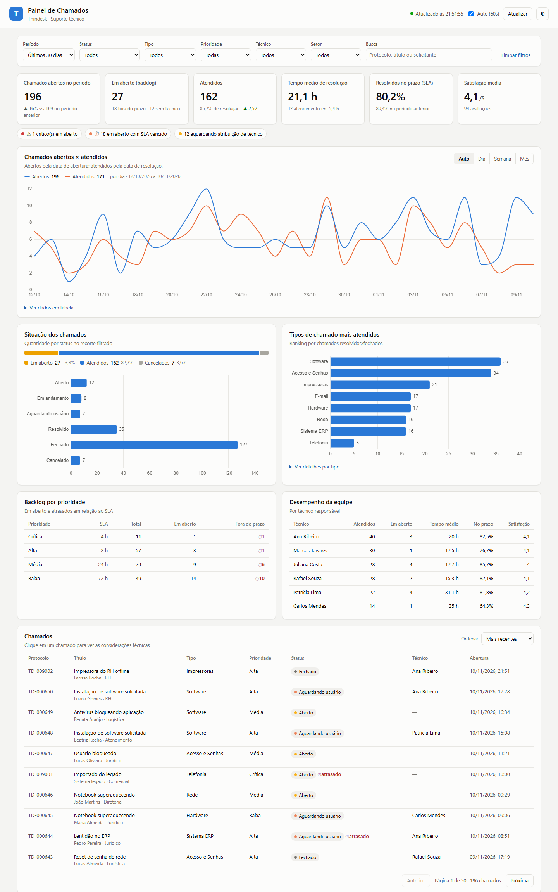
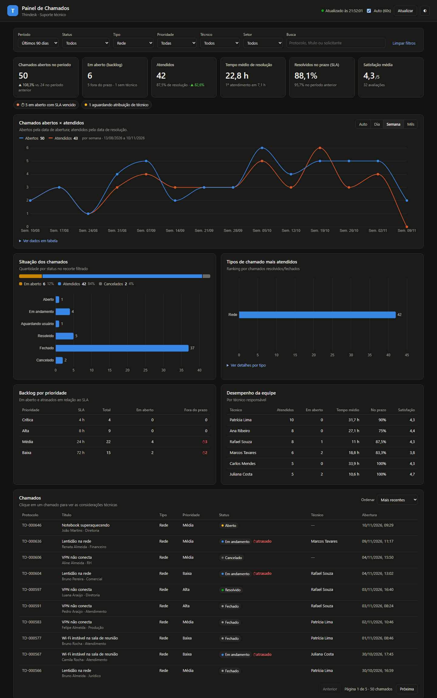
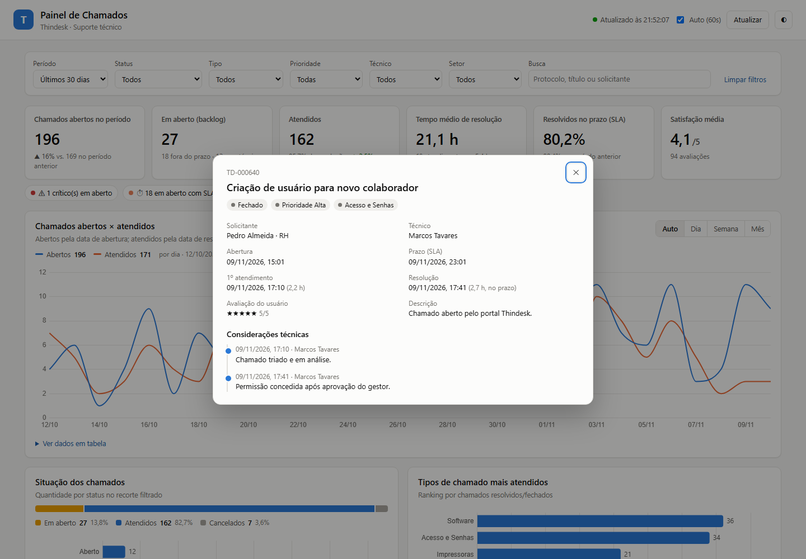
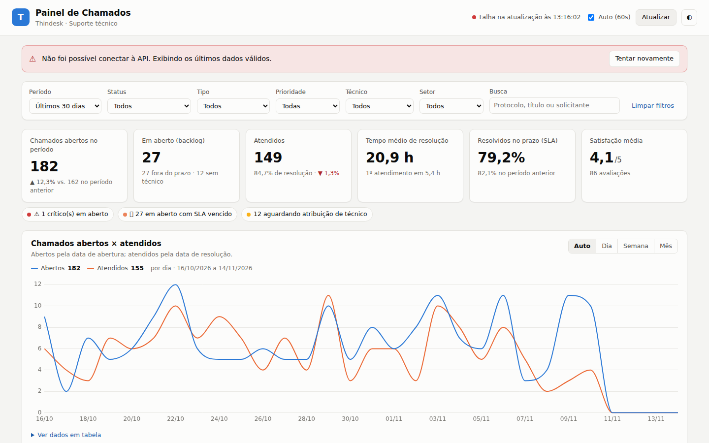
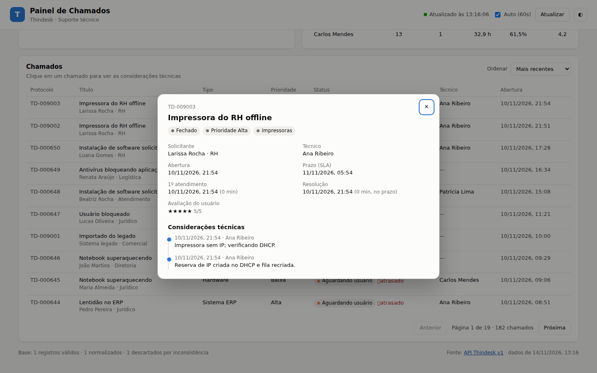
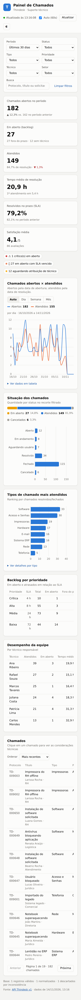

# Evidências de Testes

Foram realizados três tipos de teste:

1. **Automatizados** (unidade + integração da API) com o executor nativo do Node.js (`node:test`).
2. **Requisições manuais reais** à API em execução, registrando requisição, resposta e código HTTP.
3. **Testes visuais do dashboard** no navegador, com capturas de tela.

## 1. Testes automatizados

Como executar:

```bash
npm install
npm test
```

**Resultado: 62 testes, 62 aprovados, 0 falhas**. Saída completa em [`evidencias/resultado-testes.txt`](evidencias/resultado-testes.txt).

```
ℹ tests 62
ℹ suites 17
ℹ pass 62
ℹ fail 0
```

### Estratégia

- A API sobe em porta aleatória com um **banco SQLite em memória** contendo uma **base controlada de 8 registros** (`tests/auxiliar.js`), cujos indicadores foram calculados à mão, e com o **relógio fixo** em 10/11/2026 12:00 (Brasília). Assim cada número verificado é conhecido de antemão.
- Os testes foram escritos quando a persistência ainda era um arquivo JSON e **continuaram passando sem alteração nos valores esperados** após a migração para SQLite, o que evidencia que os cálculos em SQL reproduzem as mesmas regras.
- A base inclui um registro "sujo" recuperável (tipo `" e-mail "`, prioridade `"MÉDIA"`, status `"Aberto"`, setor `" rh"`) e um irrecuperável (data `31/02/2026`), para testar o tratamento de dados.

### Casos cobertos

| Requisito | Arquivo | O que é verificado |
|-----------|---------|--------------------|
| RF01 | `dashboard.test.js` | Total, backlog, atendidos, cancelados, taxa de resolução (50%), tempo médio de resolução (37,3 h) e de 1º atendimento (2 h), SLA (66,7%), satisfação, críticos, atrasados e sem técnico; comparativo com período anterior (variação de 150%); combinação de filtros |
| RF02 | `dashboard.test.js` | Agrupamento por dia com dias vazios preenchidos; **resolução às 21h de Brasília contada no dia certo** (00h UTC do dia seguinte); semanas começando na segunda com contagem correta por semana; agrupamento mensal; escolha automática; rejeição de agrupamento inválido e de séries grandes demais |
| RF03 | `dashboard.test.js` | Contagem por status (inclusive zeros), grupos e backlog por prioridade com atrasados |
| RF04 | `dashboard.test.js` | Ordem do ranking, empates por nome, participação, tempo médio e SLA por tipo; `limite` e `ordenarPor`; validação |
| RF05 | `dashboard.test.js`, `chamados.test.js` | 6 casos de filtro inválido → 400 com o campo correto; aceitação de rótulos/caixa/acentos; técnico `sem_tecnico`; setor normalizado; busca sem acento; paginação e ordenação |
| RF06 | `chamados.test.js` | `/saude`, `/opcoes-filtro`, cabeçalhos `no-store` e CORS, 404 padronizado, dashboard servido na raiz |
| RF07 | `chamados.test.js`, `unidade.test.js` | POST reflete nos indicadores; fluxo completo do PATCH (técnico obrigatório, transição proibida, consideração obrigatória ao resolver, avaliação só no fechamento, bloqueio após fechamento, reabertura); JSON malformado; normalizador; relatório de qualidade; importação de lote via API (corrige, descarta e atualiza indicadores); consistência e determinismo da base gerada |
| Banco | `unidade.test.js` | Persistência em arquivo entre execuções (cria, atualiza, fecha e reabre o banco); reimportação substitui registro e considerações; restrições do esquema rejeitam prioridade inexistente (FK), resolução antes da abertura (CHECK), avaliação 9 (CHECK) e protocolo duplicado (UNIQUE); a visão `vw_chamados` calcula os tempos em horas |

### Desempenho (RNF01)

Tempo de resposta medido com `curl` (melhor de 5 execuções, base com ~650 chamados), registrado em [`evidencias/tempos-resposta.txt`](evidencias/tempos-resposta.txt):

| Endpoint | Tempo |
|----------|-------|
| `GET /dashboard/indicadores` | 2,5 ms |
| `GET /dashboard/indicadores` (com período e comparativo) | 2,2 ms |
| `GET /dashboard/periodo?agrupamento=dia` | 4,1 ms |
| `GET /dashboard/status` | 5,2 ms |
| `GET /dashboard/tipos` | 3,2 ms |
| `GET /dashboard/tecnicos` | 2,5 ms |
| `GET /chamados?limite=10` | 2,6 ms |
| `GET /chamados?busca=vpn&tipo=Rede&ordenarPor=prioridade` | 2,2 ms |

Todos bem abaixo da meta de 300 ms.

### Defeitos encontrados e corrigidos durante os testes

| Defeito | Como foi detectado | Correção |
|---------|--------------------|----------|
| No agrupamento **semanal**, chamados de terça a domingo não eram contados (a chave do balde usava a data do evento, não a segunda-feira da semana) | Inspeção visual do gráfico: o filtro "Rede / 90 dias" mostrava 10 abertos na legenda, mas 52 no indicador | Chave calculada a partir do início do balde (`metricas.js`); teste de regressão adicionado em "agrupa por semana iniciando na segunda-feira" |
| Pico artificial de chamados no dia atual | Gráfico de 30 dias com ~24 chamados "hoje" contra média de ~7 | O gerador usava o dia em UTC; após 21h em Brasília, dois dias caíam em "hoje". Passou a sortear no fuso de Brasília, descartando horários futuros |
| Aviso de erro vazio aparecendo no topo | Captura de tela | `.aviso` sobrescrevia o atributo `hidden`; adicionada regra `.aviso[hidden]` |
| Link direto `?chamado=ID` não abria o detalhe | Captura de tela | A URL era reescrita pelos filtros antes de ser lida; leitura movida para antes da carga |

## 2. Requisições manuais à API

Script: [`scripts/evidencias-api.sh`](../scripts/evidencias-api.sh). Saída completa: [`evidencias/requisicoes-api.txt`](evidencias/requisicoes-api.txt).

| # | Requisição | Esperado | Obtido |
|---|------------|----------|--------|
| 1 | `GET /saude` | 200 | 200 ✔ |
| 2 | `GET /opcoes-filtro` | 200 | 200 ✔ |
| 3 | `GET /dashboard/indicadores?dataInicio=2026-10-12&dataFim=2026-11-10` | 200 com comparativo | 200 ✔ |
| 4 | `GET /dashboard/periodo?…&agrupamento=dia` | 200, 7 pontos | 200 ✔ |
| 5 | `GET /dashboard/status?tipo=Rede` | 200 | 200 ✔ |
| 6 | `GET /dashboard/tipos?limite=3` | 200, 3 posições | 200 ✔ |
| 7 | `GET /dashboard/tecnicos?dataInicio=2026-10-12` | 200 | 200 ✔ |
| 8 | `GET /chamados?limite=2&status=em_andamento&ordenarPor=prioridade` | 200 paginado | 200 ✔ |
| 9 | `GET /qualidade-dados` | 4 corrigidos, 2 descartados | ✔ |
| 9a | `POST /dados/importar` com 1 registro corrigível e 1 inválido | 200, 1 válido, 1 corrigido, 1 descartado | 200 ✔ |
| 9b | `POST /dados/importar` com objeto em vez de array | 400 | 400 ✔ |
| 10 | `POST /chamados` (tipo `impressoras`, setor `rh`) | 201 + `Location`, normalizado para `Impressoras`/`RH` | 201 ✔ |
| 11 | `PATCH` em andamento sem técnico | 422 | 422 ✔ |
| 12 | `PATCH` em andamento com técnico e consideração | 200 | 200 ✔ |
| 13 | `PATCH` resolvido sem consideração | 422 | 422 ✔ |
| 14 | `PATCH` resolvido com consideração | 200 | 200 ✔ |
| 15 | `PATCH` fechado com avaliação 5 | 200 | 200 ✔ |
| 16 | `PATCH` após fechamento | 422 | 422 ✔ |
| 17 | Filtros inválidos (`dataInicio > dataFim`, `status=pendente`) | 400 com 2 detalhes | 400 ✔ |
| 18 | `agrupamento=ano` | 400 | 400 ✔ |
| 19 | `GET /chamados/99999` | 404 | 404 ✔ |
| 20 | `GET /chamados/abc` | 400 | 400 ✔ |
| 21 | `POST /chamados` com campos faltando | 400 | 400 ✔ |
| 22 | `POST /chamados` com JSON quebrado | 400 `JSON_INVALIDO` | 400 ✔ |
| 23 | `GET /rota-inexistente` | 404 | 404 ✔ |

## 3. Testes do dashboard

Executados no Microsoft Edge com a API real, o banco SQLite e a base de exemplo (650 chamados válidos, mais os criados/importados pelas requisições acima).

| Cenário | Resultado | Evidência |
|---------|-----------|-----------|
| Carga inicial (últimos 30 dias, tema claro): indicadores, alertas, gráfico diário, situação, ranking de tipos, backlog por prioridade, equipe, lista de chamados e rodapé de qualidade de dados | ✔ |  |
| Filtros combinados (90 dias + tipo Rede), agrupamento semanal, tema escuro; todos os blocos refletem o filtro e o filtro fica na URL | ✔ |  |
| Detalhe do chamado com prazo de SLA, tempos, avaliação e linha do tempo das considerações técnicas (aberto por clique, Enter ou link `?chamado=ID`) | ✔ |  |

### Roteiro interativo (M1 a M9)

Executado em 14/11/2026 no Chromium (Playwright), simulando as ações do usuário no painel: cliques, teclado, espera real de 60 s, servidor derrubado e religado, e tela de celular de 390 px. Cada resultado esperado foi conferido no próprio navegador (textos, estado da conexão, requisições feitas à API e largura da página). Registro completo: [testes-interativos.txt](evidencias/testes-interativos.txt).

| # | Passos | Resultado esperado | Resultado obtido | Status |
|---|--------|--------------------|------------------|--------|
| M1 | Deixar o painel aberto por mais de 60 s | Horário "Atualizado às" muda sozinho | "Atualizado às 13:15:01" passou a "13:16:01" sem interação; 7 requisições à API | ☑ |
| M2 | Clicar em "Atualizar" | Horário muda; dados recarregados | "13:16:01" passou a "13:16:02"; 7 requisições à API | ☑ |
| M3 | Com o painel aberto, parar o servidor e clicar em "Atualizar" | Aviso de falha, indicador vermelho, dados anteriores mantidos | Aviso "Não foi possível conectar à API. Exibindo os últimos dados válidos.", indicador vermelho "Falha na atualização", indicadores iguais aos de antes ([print](evidencias/04-api-indisponivel.png)) | ☑ |
| M4 | Religar o servidor e clicar em "Tentar novamente" | Aviso some, indicador verde | Aviso oculto, "Atualizado às 13:16:03" | ☑ |
| M5 | Período "Personalizado", escolher datas | Campos De/Até aparecem; todos os blocos refletem o intervalo | Campos visíveis; 01/08 a 31/08/2026 enviado a indicadores, período, status, tipos, técnicos e chamados; filtro gravado na URL | ☑ |
| M6 | "Limpar filtros" | Volta para "Últimos 30 dias" sem outros filtros | Período "Últimos 30 dias", demais filtros vazios, URL sem parâmetros | ☑ |
| M7 | Usar "Próxima"/"Anterior" e o seletor "Ordenar" | Lista muda de página/ordem sem recarregar os gráficos | Página 1 para 2 e de volta; ordenação "mais antigos" trocou a 1ª linha; nenhuma requisição aos endpoints dos gráficos | ☑ |
| M8 | Abrir em tela de 390 px | Layout em uma coluna, sem rolagem horizontal da página | Largura do conteúdo 390 px = largura da tela; 10 blocos em uma coluna ([print](evidencias/05-celular-390px.png)) | ☑ |
| M9 | Clicar em um chamado e navegar com Tab + Enter | Modal de detalhe abre; Esc fecha | Clique abriu o detalhe; Tab a partir de "Ordenar" focou a linha (contorno de foco visível); Enter abriu o detalhe com as considerações técnicas; Esc fechou ([print](evidencias/06-detalhe-teclado.png)) | ☑ |

Resultado: **9 de 9 casos aprovados**, sem erros de JavaScript na página.

| API fora do ar (M3) | Detalhe aberto pelo teclado (M9) | Celular, 390 px (M8) |
|---|---|---|
|  |  |  |
